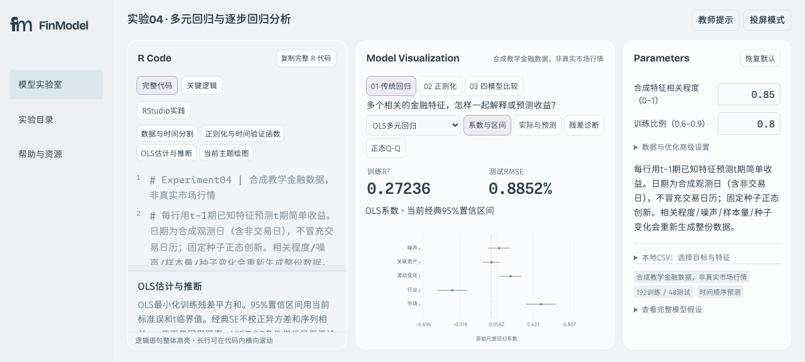

# FinModel Lab

### Interactive Financial Modeling Lab for R Education

**FinModel Lab 是一款面向高校金融实验课程的交互式建模教学平台，旨在连接金融理论、模型可视化与可执行的 R 语言实践。**

项目围绕高校《基于R语言的投资与实验》课程设计，将抽象的金融与统计模型转化为可直接操作的实验。学生可以调整参数、观察模型变化、查看数学解释，并将当前模型对应的完整R代码复制到R环境中运行。

**[在线体验 FinModel Lab](https://finmodel-lab.app.workbuddy.host/?sharecode=PLWKCGJYNW)** · **[查看实验04](https://finmodel-lab.app.workbuddy.host/experiments.html?sharecode=PLWKCGJYNW&model=regression)**

> 在线版本由WorkBuddy托管。首次访问请使用完整分享链接，无须安装桌面软件。R代码的独立运行需要本地R环境。



## 01. Project Overview

传统金融建模实验通常要求学生在理解数学公式的同时，独立编写R代码、调整模型参数并分析统计输出。

对于初学者而言，模型推导、编程操作和金融解释之间存在一定的学习门槛。

FinModel Lab尝试通过统一的交互式工作台连接这三个环节：

**Model → Visualization → R Code → Interpretation**

项目的核心设计原则：

- **Interactive Exploration：** 直接调整参数，观察模型结果实时变化。
- **Executable R Code：** 默认展示完整代码，支持复制和独立运行。
- **Mathematical Transparency：** 展示公式、参数含义、模型假设及计算逻辑。
- **Finance-Oriented Learning：** 将统计结果与实际金融问题联系起来。
- **Low-Friction UX：** 保持自由探索，不设置强制答题或分步解锁。
- **Reproducibility：** 对核心计算进行数值验证，并明确数据与模型限制。

## 02. Core Experiments

目前已完成六个核心金融建模实验，对应课程中的不同教学主题。

| 实验 | 主题 | 主要功能 |
|---|---|---|
| 04 | Multiple Regression | OLS、逐步回归、Ridge、Lasso与样本外比较 |
| 06 | Volatility Modeling | ARCH-LM、GARCH、GJR-GARCH、GARCH-M、CCC-GARCH |
| 07 | Financial Risk Measurement | VaR、ES、RiskMetrics、EVT与风险回测 |
| 08 | Portfolio Optimization | 均值-方差模型、全局最小方差组合、有效前沿 |
| 09 | CAPM | SML、CML、Alpha/Beta估计与实证分析 |
| 11 | Black-Scholes | 欧式期权定价、Greeks、隐含波动率与Delta对冲 |

其他课程实验尚未上线，不属于当前版本的完成范围。

### Experiment 04 · Regression & Regularization

使用统一金融数据比较传统统计回归与正则化方法。

- 多元最小二乘回归（OLS）
- 前向、后向与双向逐步回归
- Ridge L2正则化
- Lasso L1正则化
- 多重共线性与VIF诊断
- 时间顺序训练、验证和测试
- 四模型预测误差比较

**核心问题：训练数据上拟合更好的模型，是否一定能更准确地预测新数据？**

### Experiment 06 · Volatility Modeling

探索金融收益率中的波动率聚集及条件波动模型。

支持ARCH效应检验、GARCH参数估计、标准化残差诊断、多期波动率预测、不对称波动分析以及双资产条件协方差建模。

### Experiment 07 · Value at Risk & Expected Shortfall

比较不同风险计量方法对潜在损失的估计。

支持历史模拟法、正态参数法、EWMA、GARCH-VaR/ES、POT-GPD极值分析与样本外风险回测。

### Experiment 08 · Portfolio Optimization

通过双资产与多资产模型，探索收益、风险和资产相关性之间的关系。

支持全局最小方差组合、有效前沿、权重调整及历史数据导入。

### Experiment 09 · Capital Asset Pricing Model

结合理论与样本回归理解CAPM。

支持证券市场线、资本市场线、Beta敏感度、Alpha检验和回归诊断。

### Experiment 11 · Black-Scholes & Hedging

探索欧式期权价格如何受到基础资产价格、波动率、期限和利率影响。

支持期权定价、Greeks、隐含波动率数值求解与动态Delta对冲模拟。

## 03. Product Design

### Three-Panel Workbench

FinModel Lab采用统一的三栏工作台：

| R Code | Model Visualization | Parameters |
|---|---|---|
| 完整可执行代码 | 交互式模型图表 | 实时参数调整 |
| 代码段导航 | 金融结果与模型比较 | 高级模型设置 |
| 数学解释联动 | 动态金融解释 | 数据导入与重置 |

学生可以从图表出发理解模型，也可以直接阅读代码与公式。

三栏各自承担明确任务，减少在R代码、参数输入和统计输出之间反复切换的操作。

### Design Decisions

**1. Full Code by Default**

默认提供完整R脚本，而不是只展示几行关键代码，确保学生能够从数据输入追踪到最终输出。

**2. Free Exploration**

取消强制教学步骤，让用户自由切换模型、修改参数和比较结果。

**3. Mathematical Explainability**

通过代码与公式联动，解释模型为什么得到当前结果，同时明确统计假设及适用边界。

**4. Shared Financial Data**

在适用的实验中支持本地CSV导入，让学生能够使用自己的数据完成建模和比较。

## 04. Technology

| 层级 | 技术与实现 |
|---|---|
| Frontend | HTML、CSS、JavaScript |
| Visualization | SVG、交互式金融图表 |
| Mathematical Rendering | KaTeX |
| Financial Computing | 浏览器端数值计算与优化 |
| R Integration | 完整R脚本生成与跨语言数值核验 |
| Data Input | 本地CSV解析与验证 |
| Development Tools | Node.js、Python |
| Deployment | 静态网站部署 |

核心金融交互主要在浏览器中执行，不需要用户将模型参数提交到远程计算服务。

R代码用于教学实践与结果复现，并不意味着浏览器直接运行R解释器。

## 05. Run Locally

克隆仓库：

```bash
git clone https://github.com/yanghang-bcz/finmodel-lab.git
cd finmodel-lab
```

使用Python启动已经构建好的静态网站：

```bash
python3 -m http.server 8765 --directory dist
```

打开：

`http://127.0.0.1:8765/`

实验04：

`http://127.0.0.1:8765/experiments.html?model=regression`

如需修改JavaScript源模块并重新构建，可使用项目中的构建脚本：

```bash
node tools/build-workbench.cjs
```

部分R示例需要安装对应的R包，例如正则化回归使用的`glmnet`。网页交互与独立R脚本运行是不同的执行环境。

## 06. Repository Structure

```text
finmodel-lab/
├── dist/                    # 可部署静态网站
├── examples/                # 可运行R语言示例
├── tests/                   # 数学、R及浏览器测试
├── tools/                   # 构建与开发工具
├── deploy-evidence/         # 部署验证和界面截图
├── CLASSROOM-EXPERIMENT04.md
├── EXPERIMENT04-FINAL.md
├── EXPERIMENT06-FINAL.md
├── EXPERIMENT07-V2.7.2-FINAL-VALIDATION.md
└── README.md
```

详细实验验证及设计决策参见：

- [Experiment 04 · 回归与正则化](EXPERIMENT04-FINAL.md)
- [Experiment 06 · 波动率模型](EXPERIMENT06-FINAL.md)
- [Experiment 07 · 风险计量](EXPERIMENT07-V2.7.2-FINAL-VALIDATION.md)
- [Experiment 08 · 投资组合优化](EXPERIMENT08-UPGRADE.md)
- [Experiment 09 · CAPM](EXPERIMENT09-V2.4.1-UX.md)
- [Experiment 11 · Black-Scholes](EXPERIMENT11-ROUND3.md)

## 07. Validation & Limitations

FinModel Lab的核心金融计算经过多轮自动化测试，包括数学边界、数值优化、JavaScript与R结果对照、浏览器交互及跨实验回归检查。

各实验的测试方法、执行记录和已知限制保留在相应交付报告中。

**Current limitations**

- 平台目前覆盖六个核心实验，并非完整覆盖课程全部12个实验。
- 默认示例主要使用合成教学数据，不代表真实市场行情。
- 模型输出用于教学与分析，不构成投资建议。
- 数学与软件验收不等于模型具有真实市场预测能力。
- 真实课堂学习效果仍需通过教师反馈和学生试用进行验证。

## 08. Roadmap

当前阶段不再优先增加金融模型，而是集中于实际教学场景验证。

- [x] 六个核心金融建模实验
- [x] 统一交互式工作台
- [x] 完整R代码生成与复现
- [x] 数学和浏览器自动化验证
- [x] 在线演示部署
- [ ] 正式课堂试用与学生任务评估
- [ ] 根据教师反馈优化教学流程
- [ ] 评估后续课程实验扩展需求

---

**FinModel Lab** is an independently developed educational technology project exploring how interactive visualization, reproducible code, and financial modeling can improve the experience of learning quantitative finance.
